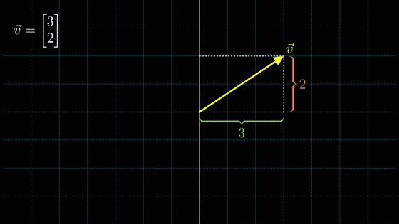

# Syllabus-to-Video

[](https://github.com/JohnathanG56/syllabus-to-video/actions/workflows/ci.yml)

Upload a course syllabus and get a short, narrated, 3Blue1Brown-style animated lesson for each topic.

An LLM reads the syllabus, writes a 60–120 s script for each topic and then writes **Manim** animation code for it. That code is **untrusted**, so it is checked by an AST validator and rendered inside a locked-down Docker sandbox. When a render fails, the error is classified and sent back to the model in a **self-repair loop** (at most K = 3 repairs). Narration comes from **Piper** TTS, and **ffmpeg** muxes video, voice and captions together. A SQLite-backed job queue and a small web UI tie it together.



**Demo outputs:** [`docs/demo-vectors-as-arrows.mp4`](docs/demo-vectors-as-arrows.mp4) (67.4 s) · [`docs/demo-pythagorean-theorem.mp4`](docs/demo-pythagorean-theorem.mp4) (63.1 s) · [captions](docs/demo-vectors-as-arrows.srt)

> The two demo videos came from `python -m demo`, which runs the whole pipeline with a **fake LLM** that returns hand-written scripts and Manim code. Everything after the LLM was real: Piper narration, validation, Manim renders, the repair loop and ffmpeg. The vectors lesson's first code draft deliberately uses the manimgl-era `ShowCreation`. That raised a real `NameError` in the render, and the repair loop fixed it. See [How these demo files were made](#how-the-demo-files-in-docs-were-made) for exactly what ran where.

---

## Why

Short visual explanations are among the best ways to learn math and CS, but each one takes an expert animator hours. LLMs can write Manim code, but on its own that code often fails to render. It calls APIs that don't exist (many models mix up Manim Community and 3b1b's manimgl), has LaTeX errors, or drifts out of sync with the voice-over. And executing model-written code on your machine is a security problem. This project treats those three issues as the engineering work:

1. **Reliability:** a validate → render → classify → repair loop, with every attempt logged so the failure modes can be measured.
2. **Sync:** narration is synthesized *first*. The animation is generated to fit the measured audio durations, and the result is checked with ffprobe.
3. **Safety:** a static gate plus a container sandbox. The container, not the static gate, is the security boundary.

## Architecture

```
              ┌──────────── web/ (HTML+JS, polls every 2 s) ────────────┐
              │                                                          │
   upload ──► api/  FastAPI ── POST /syllabi ─► SQLite: syllabi, topics, jobs, render_attempts, llm_calls
                                                   ▲            │ (jobs table = the queue, no Redis)
                                                   │            ▼
                                        worker/  thread pool, claims jobs atomically,
                                                 heartbeats, requeues stale jobs, RENDER_CONCURRENCY=2
                                                            │
     pipeline/ (one module per stage, each idempotent)      ▼
     ingest ─► topics ─► script ─► narration ─► codegen ─► repair loop ──────────► assemble
     pypdf     LLM       LLM       Piper TTS    LLM        │                          ffmpeg mux
     + clean   (JSON)    (JSON)    WAV per      (JSON)     │  inject timing           tpad / apad
                                   segment,                │  AST validate            SRT captions
                                   durations ──────────────┤  sandbox render -ql      out/{syllabus}/{n}-{slug}.mp4
                                   (timing budget)         │  classify error
                                                           │  repair prompt (≤ K)
                                                           │  ffprobe duration check
                                                           ▼
                                   sandbox/  DockerRunner: --network none --read-only --memory 2g
                                             --cpus 2 --pids-limit 256 --cap-drop ALL
                                             --security-opt no-new-privileges, tmpfs /tmp,
                                             host-side kill on timeout
                                             LocalRunner: UNSAFE dev fallback (rlimits + timeout)
```

**Topic state machine:** `queued → scripted → narrated → coded → rendering → (repairing) → assembled → done | failed`. Each transition is persisted. Each stage looks for its own output first (the script in the DB, WAVs on disk, `validated.json`/`final.json` markers, the final MP4), so a crashed worker picks up where it left off without new LLM spend.

**LLM contract:** every model output is JSON, validated by a strict pydantic schema (`extra="forbid"`). If validation fails, the model gets exactly one retry with the validation error appended. The LLM sits behind a three-method interface (`core/llm.py`): `AnthropicLLM` uses the official SDK, and `ScriptedLLM` is the fake used by tests and demo mode.

### The timing contract (why narration comes first)

1. Piper synthesizes each segment, and we measure each WAV (plus a 0.35 s pause).
2. The pipeline **injects** `SEGMENT_DURATIONS` and `SEGMENT_ENDS` into the generated file, so the model never writes timing numbers.
3. The model ends segment *i* with `self.sync_to(i)`, which waits until the *absolute* time `SEGMENT_ENDS[i]`. An overrun in one segment is absorbed at the next sync instead of piling up drift.
4. After rendering, ffprobe checks that video length equals narration length (±1 s). A mismatch becomes a `duration_mismatch` repair. On the final attempt the video is accepted with a warning, and assembly pads it (`tpad=stop_mode=clone` holds the last frame).

### The self-repair loop

| Error class | Detected by | Hint given to the model |
|---|---|---|
| `validation` | AST gate (before rendering) | remove the forbidden construct |
| `syntax` | `ast.parse` / `SyntaxError` | fix the exact line |
| `hallucinated_api` | `NameError`, `AttributeError`, `ImportError`, bad-kwarg `TypeError` | use the Manim CE spelling (`ShowCreation` → `Create`, `get_graph` → `plot`, …) |
| `latex` | LaTeX/dvisvgm markers in the output | plain amsmath, balanced braces |
| `timeout` | host-side kill | no loops, fewer mobjects |
| `oom` | exit 137 / `MemoryError` | fewer objects |
| `duration_mismatch` | ffprobe vs narration | `sync_to` every segment |
| `other` | everything else | read the traceback |

The repair prompt contains the error class, its hint, a **trimmed traceback** (scene-file frames, the innermost frame and the exception, with framework noise dropped), and the **line-numbered code**, so line numbers in the traceback match the code the model sees. Classification uses the real exception type: `sandbox/render_entry.py` runs inside the sandbox and writes `result.json`, so the host never has to scrape Manim's console output. Every attempt goes into `render_attempts(topic_id, attempt_no, phase, error_class, exit_reason, render_seconds, success, …)`.

## Security model

**Threat:** the model, or a prompt injection hidden in an uploaded syllabus, emits Python that reads your files, steals the API key, mines crypto, fork-bombs, or reaches the network.

**Layer 1: AST validator** (`pipeline/validator.py`, runs before any render):
- imports only from `from manim import *`, `numpy` and `math`;
- no `eval`, `exec`, `compile`, `open`, `__import__`, `getattr`, `setattr`, `delattr`, `globals`, `locals`, `vars`, `input`, `breakpoint`;
- no dunder attribute access (`().__class__.__bases__…`) and no dunder names;
- no file/asset loaders (`ImageMobject`, `SVGMobject`, `Code`, `add_sound`, `np.load`, `np.fromfile`, …);
- **names leaked by `from manim import *`**: it exports about 580 names, including `capture` (a `subprocess.Popen` wrapper), `guarantee_empty_existence` (calls `rmtree`), `open_file`, `config`, and module objects such as `utils` that chain to `os` and `subprocess`. These are blocked as names, and attribute hops to `os`, `subprocess`, `sys`, `socket`, `Path`, … are blocked too;
- no top-level side effects, at most 400 lines, exactly one `LessonScene(Scene)` with `construct`.

**What the AST gate cannot catch:** Python is too dynamic for a deny-list to be complete. Expect escapes via objects reachable from allowed names, string-built attribute access through some allowed API, or a gadget nobody has thought of. The gate mostly catches honest model mistakes cheaply (no container start, a precise message for the repair prompt) and shrinks the attack surface. **It is not the boundary.**

**Layer 2: container sandbox (the real boundary).** Each render runs in a throwaway container: `--network none`, `--read-only` root FS with a 512 MB tmpfs `/tmp`, `--memory 2g --memory-swap 2g`, `--cpus 2`, `--pids-limit 256`, `--cap-drop ALL`, `--security-opt no-new-privileges`, and an unprivileged uid. Only the scene file (read-only) and an output dir are mounted. The host kills the container by name on timeout. The container never sees the API key, because no environment is passed through. Tests prove these properties ([tests/test_sandbox.py](tests/test_sandbox.py)): network attempts fail, writes outside `/out` fail, 1,000 threads hit the pids limit, a memory hog is reported as `oom`, an infinite loop is killed, and no `stv-render-*` container is left running.

**Residual risks:** a container is not a VM, so a kernel exploit could escape it. gVisor (`--runtime=runsc`) or Firecracker would be the next step. Mounting `docker.sock` into the worker container (compose mode) gives that container root-equivalent control of the host; the recommended setup runs the worker natively. LaTeX inside the sandbox could be abused (`\write18`), and the sandbox contains that too. `RENDER_BACKEND=local` is **not** a sandbox: it adds rlimits, a timeout and a scrubbed environment, and exists only for development.

## Setup on an Apple Silicon Mac

Prerequisites: [Docker Desktop](https://www.docker.com/products/docker-desktop/) running, Homebrew, and Python 3.11+.

```bash
brew install python@3.12 ffmpeg
git clone <your-repo-url> syllabus-to-video && cd syllabus-to-video

python3.12 -m venv .venv && source .venv/bin/activate
pip install -r requirements-dev.txt          # API, worker, pipeline, piper-tts, pytest

# 1) the render sandbox (pulls manimcommunity/manim:v0.19.0, which has Manim + LaTeX + ffmpeg)
docker build -t stv-manim-sandbox:latest sandbox/
#    if the base image has no arm64 variant for your tag, add --platform linux/amd64 (runs under Rosetta)

# 2) the Piper voice (~63 MB, cached in voices/)
python scripts/download_voice.py

# 3) secrets + model
cp .env.example .env
#    edit .env: ANTHROPIC_API_KEY=sk-ant-...   LLM_MODEL=<a current Claude model id>
#    (model ids: https://docs.anthropic.com/en/docs/about-claude/models)

# 4) sanity checks
pytest -q                                    # docker-marked tests run now that the image exists
python -m demo --fresh                       # offline demo, no API key needed -> out/demo/1/*.mp4
```

### Run it

```bash
# terminal 1: API + web UI on http://localhost:8000
uvicorn api.main:create_app --factory --port 8000

# terminal 2: worker (renders through the Docker sandbox)
python -m worker
```

Open <http://localhost:8000>, then drop in a PDF (try `tests/fixtures/sample_syllabus.pdf`) or paste text. Each topic card shows a live stepper (script → narration → animation code → sandboxed render → assembly), repair attempts, and the finished video with captions. You can also use the API directly: `POST /syllabi` (multipart `file` or form `text`), `GET /syllabi/{id}`, `GET /topics/{id}` (script, code, every render attempt, token usage), and `GET /videos/{path}`.

To browse the demo output in the UI: `DATA_DIR=data/demo OUT_DIR=out/demo uvicorn api.main:create_app --factory`.

**docker compose (alternative):** `docker compose up --build` runs the API and the worker in containers. The worker reaches the host Docker daemon through the mounted socket to start sandbox containers. Read the trade-off comment in [`docker-compose.yml`](docker-compose.yml) first.

**Cost control:** `MAX_TOPICS` (default 8) caps topics per syllabus, `MAX_REPAIRS` (default 3) caps repairs, and `llm_calls` records tokens for every call.

## Evaluation

```bash
python -m eval.run_eval                       # 25 fixed topics (eval/topics.json), K=3, docker sandbox
python -m eval.run_eval --limit 5 --jobs 2    # quick look
python -m eval.run_eval --with-narration      # real Piper durations instead of word-count estimates
```

For each topic the harness runs: LLM script → durations → LLM code → sandboxed render with up to K repairs. It writes `results.csv`, `summary.json` and `summary.md` to `eval/results/<timestamp>/` and reports:

- first-try render success %, and success % after ≤ K repairs
- average attempts
- error-class breakdown (all failed attempts, and first attempts only)
- average wall time and render time per video
- LLM tokens per video

**It refuses to run without `ANTHROPIC_API_KEY` and `LLM_MODEL`.** No code path produces numbers without a real model. `--fake-llm` exists only to test the harness, and every file it writes is stamped `SYNTHETIC`.

### Eval results

<!-- Fill from eval/results/<timestamp>/summary.md after a real run:
| Metric | Value |
|---|---|
| Model (`LLM_MODEL`) | |
| Topics evaluated | 25 |
| First-try render success | % |
| Success after <= 3 repairs | % |
| Avg attempts per topic | |
| Most common first-attempt failure class | |
| Avg wall time per video | s |
| Avg LLM tokens per video (in / out) | |
-->

### Render timings (hand-written demo scenes)

These numbers come from the environment the project was built in: Linux x86_64, 2 vCPUs, 7 GB RAM, `RENDER_BACKEND=local`. They describe the hand-written demo scenes, not LLM output.

| What | Measured |
|---|---|
| `python -m demo` wall time, 2 lessons, both topics in parallel | 113.8 s |
| Validation render (-ql, 480p15) of a ~65 s lesson | 19.3 s and 21.3 s |
| Final render (-qm, 720p30) of the same lessons | 53.6 s and 47.6 s |
| Failing first attempt (`NameError`) caught and classified | 2.3 s |
| Output length vs narration total | 67.4 s / 67.4 s and 63.0 s / 63.0 s |
| Test suite | 225 tests, all passing (incl. Docker, Manim and Piper tests; see caveats below) |

## How the demo files in `docs/` were made

The build container could not reach Docker Hub or PyPI, so:
- **Manim 0.19.0** was built from its GitHub sources (with PyAV, ManimPango, pycairo, mapbox-earcut and moderngl compiled locally). `skia-pathops`, which Manim uses only for boolean shape operations, was replaced by a local stub. The demo does not use those operations.
- **`dvisvgm` was unavailable**, so MathTex went through a small shim (`latex → dvipdfmx → pdftocairo -svg`) that lives outside this repo. The real sandbox image ships the real dvisvgm.
- Renders used **`RENDER_BACKEND=local`**. The **Docker runner** was tested against a locally assembled image (the same Manim build in a minimal rootfs, run with the exact hardening flags), because `manimcommunity/manim` could not be pulled. On your Mac, `docker build sandbox/` uses the official image, and CI does the same.
- **Piper** was the standalone Piper binary (`scripts/download_voice.py --binary`), with the `en_US-lessac-medium` voice from the rhasspy/piper GitHub release. Your Mac will use `pip install piper-tts` and the Hugging Face voice.

## Tests

```bash
pytest -q                           # everything available on this machine
pytest -q -m "not docker and not manim"   # fast: 209 tests, about 30 s, no Manim or Docker needed
```

Markers auto-skip when a dependency is missing: `docker` (daemon + image), `manim` (Manim importable), `piper` (voice + engine), `ffmpeg`. The LLM is always mocked. Highlights:
- **test_validator.py:** malicious samples (imports, eval/exec, dunder escapes, `capture`/`rmtree` leaks, asset loaders) and legitimate code.
- **test_repair.py:** a fake LLM returns broken-then-fixed code and the loop recovers and logs; the loop gives up after exactly K repairs; every error class is covered; plus a real Manim render that recovers from `NameError`.
- **test_sandbox.py:** timeout kill, no network, read-only root, pids and memory caps, no secret leakage.
- **test_worker_e2e.py:** upload → worker → video served over HTTP, retries, concurrency cap.
- **test_demo.py:** the full demo, end to end.

CI (`.github/workflows/ci.yml`) has three jobs: unit tests, real Manim renders, and Docker sandbox tests built from the official image.

## Configuration

All settings come from environment variables or `.env` (see [`.env.example`](.env.example)). The main ones:

| Variable | Default | Meaning |
|---|---|---|
| `ANTHROPIC_API_KEY`, `LLM_MODEL` | none | required for real runs |
| `RENDER_BACKEND` | `docker` | `docker` (sandbox) or `local` (UNSAFE, dev only) |
| `SANDBOX_IMAGE` | `stv-manim-sandbox:latest` | image built from `sandbox/Dockerfile` |
| `MAX_REPAIRS` | `3` | K |
| `VALIDATE_QUALITY` / `FINAL_QUALITY` | `l` / `m` | Manim quality for the repair loop and the final render |
| `VALIDATE_TIMEOUT_S` / `FINAL_TIMEOUT_S` | `180` / `600` | host-side kill |
| `RENDER_CONCURRENCY` / `WORKER_THREADS` | `2` / `4` | parallel renders / parallel jobs |
| `TTS_BACKEND` | `auto` | `piper-python`, `piper-cli`, or `silent` |
| `PIPER_VOICE`, `PIPER_LENGTH_SCALE` | `voices/en_US-lessac-medium.onnx`, `1.1` | voice and speaking pace |
| `BURN_CAPTIONS` | `0` | burn subtitles into the pixels (needs libass); soft subtitles are always included |
| `MAX_TOPICS` | `8` | topics per syllabus |

## Layout

```
api/        FastAPI app (create_app factory) + video/caption serving
worker/     SQLite job queue consumer (python -m worker)
pipeline/   ingest, topics, script, narration, codegen, validator, repair, errors, assemble, orchestrator, media
sandbox/    Dockerfile, run.py (DockerRunner / LocalRunner), render_entry.py (runs inside the sandbox)
prompts/    topics.md, lesson_script.md, manim_codegen.md, repair.md, examples/*.py (rendered in tests)
core/       config, db (SQLite schema + queue), llm (interface + Anthropic + fake), schemas, prompts
eval/       run_eval.py + topics.json (fixed 25 topics)
demo/       offline demo: hand-written LLM outputs + python -m demo
web/        index.html, app.js, style.css
tests/      pytest suite (+ fixtures/sample_syllabus.{txt,pdf})
docs/       demo videos, GIF, captions
```

## Limitations and next steps

- Visual quality depends on the model. The repair loop guarantees a video *renders*, not that it is *good*. A next step is a vision-model critic on sampled frames (overlaps, off-screen objects, unreadable text) that feeds a "visual" error class.
- `-ql` validation renders still cost real CPU. Possible fixes: cache by code hash, a dry-run mode that only runs `construct()` without encoding, or GPU/OpenGL rendering.
- No auth or multi-tenant isolation in the API. Uploads are capped at 10 MB, but anything public needs auth, rate limits and per-user quotas.
- The sandbox is a container, not a VM. Use gVisor or Firecracker for hostile multi-tenant use.

